<picture><source media="(max-width: 640px)" srcset="assets/header-mobile.svg"/></picture>

<a href="https://portfolio-one-rust-99.vercel.app/"><picture><source media="(max-width: 640px)" srcset="assets/typing-mobile.svg"/></picture></a>

## 💻 `> whoami`

<picture><source media="(max-width: 640px)" srcset="assets/idcard-mobile.svg"/></picture>

## ⚡ `> sudo install --tech-stack`

<picture><source media="(max-width: 640px)" srcset="assets/skills-mobile.svg"/></picture>

## 🚀 `> featured_builds --live`

<picture><source media="(max-width: 640px)" srcset="assets/builds-mobile.svg"/></picture>

## 📊 `> system.scan()`

<picture><source media="(max-width: 640px)" srcset="assets/stats-mobile.svg"/></picture>

<h2 align="center">🐍 <code>contribution_snake</code></h2>

<!-- Generate the SVGs with the Platane/snk workflow (https://github.com/Platane/snk)
     in THIS repo (phamdung2301/phamdung2301), output branch — then the animation appears below. -->

  <picture>
    <source media="(prefers-color-scheme: dark)" srcset="https://raw.githubusercontent.com/phamdung2301/phamdung2301/output/github-contribution-grid-snake-dark.svg"/>
    <source media="(prefers-color-scheme: light)" srcset="https://raw.githubusercontent.com/phamdung2301/phamdung2301/output/github-contribution-grid-snake.svg"/>
    
  </picture>

<i>Thanks for stopping by. Have a great day! ✌️</i>

<picture><source media="(max-width: 640px)" srcset="assets/footer-mobile.svg"/></picture>

