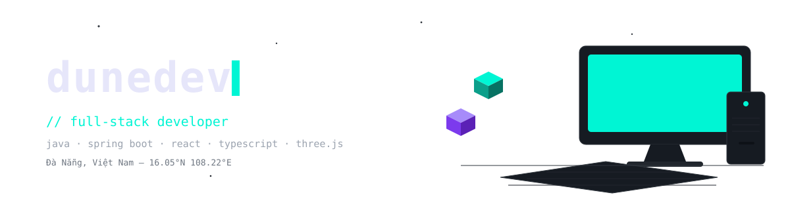
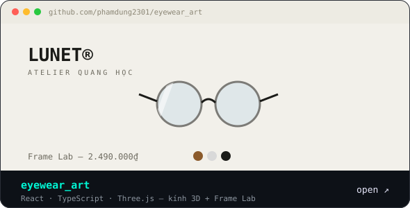
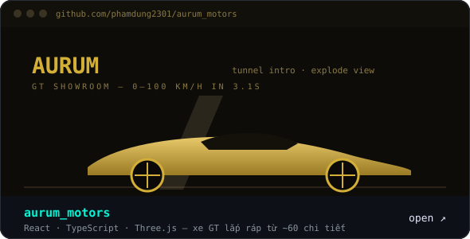
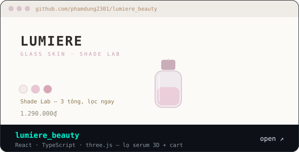
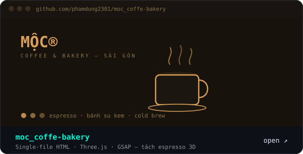
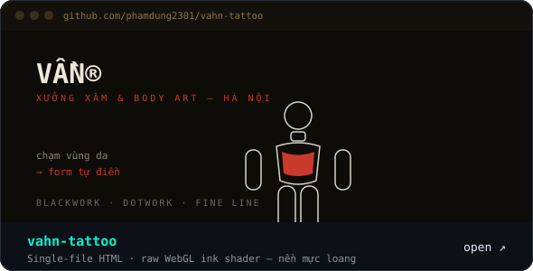
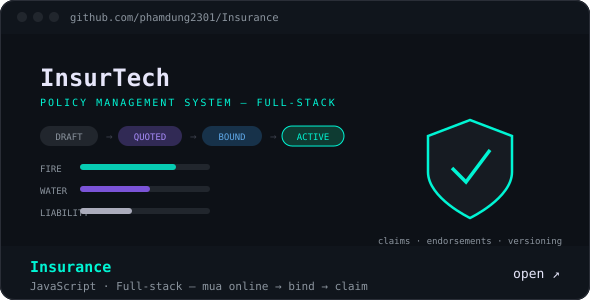

<picture><source media="(max-width: 640px)" srcset="assets/dunedev/header-mobile.svg"/></picture>


## `>_ whoami`

```java
public class Developer {

    private final String role            = "Junior Full-Stack Developer";
    private final String primaryLanguage = "Java";
    private final String currentFocus    = "Spring Boot backends · REST APIs · the web in three dimensions";

    public String getMindset() {
        return "Learn consistently. Build useful things. Improve every day.";
    }
}
```


## `>_ stack`

<div align="center">
  
  <p><sub><b>Jv</b> java · <b>Sb</b> spring · <b>My</b> mysql · <b>Pg</b> postgres · <b>Dk</b> docker · <b>Gt</b> git · <b>Ht</b> html · <b>Cs</b> css · <b>Js</b> js · <b>Re</b> react · <b>Ts</b> ts · <b>Py</b> python</sub></p>
</div>


## `>_ builds`

<p align="center">
  <a href="https://eyewear-art-mu.vercel.app"></a>
  <a href="https://aurummotors.vercel.app"></a>
</p>
<p align="center">
  <a href="https://lumiere-beauty-woad-nine.vercel.app"></a>
  <a href="https://moccoffe-bakery.vercel.app"></a>
</p>
<p align="center">
  <a href="https://vahn-tattoo.vercel.app"></a>
  <a href="https://insurance-ten-theta.vercel.app"></a>
</p>


## `>_ stats`

<div align="center">
  
  
</div>


## `>_ contribution --dragon`

<div align="center">
  <picture>
    <source media="(prefers-color-scheme: dark)" srcset="https://raw.githubusercontent.com/phamdung2301/phamdung2301/output/dragon-dark.svg"/>
    <source media="(prefers-color-scheme: light)" srcset="https://raw.githubusercontent.com/phamdung2301/phamdung2301/output/dragon-light.svg"/>
    
  </picture>
</div>


<div align="center">
  <a href="https://github.com/phamdung2301"></a>
  <p><i>thanks for stopping by — have a great day.</i></p>
</div>


