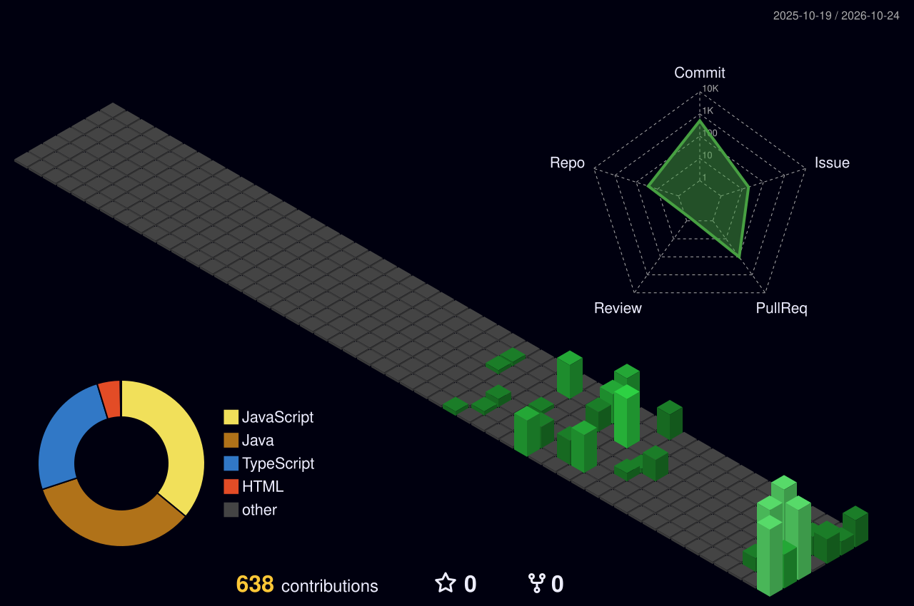

<picture><source media="(max-width: 640px)" srcset="assets/dunedev/header-mobile.svg"/></picture>


## `>_ whoami`

```java
public class Developer {

    private final String role            = "Junior Full-Stack Developer";
    private final String primaryLanguage = "Java";
    private final String currentFocus    = "Spring Boot backends · REST APIs · the web in three dimensions";

    public String getMindset() {
        return "Learn consistently. Build useful things. Improve every day.";
    }
}
```


## `>_ stack`

<p align="center">
  
</p>


## `>_ builds`

<p align="center">
  <a href="https://github.com/phamdung2301/eyewear_art"></a>
  <a href="https://github.com/phamdung2301/aurum_motors"></a>
</p>
<p align="center">
  <a href="https://github.com/phamdung2301/erp"></a>
  <a href="https://github.com/phamdung2301/moc_coffe-bakery"></a>
</p>

<p align="center"><sub>more — <a href="https://github.com/phamdung2301/lumiere_beauty">lumiere_beauty</a> · <a href="https://github.com/phamdung2301/vahn-tattoo">vahn-tattoo</a> · <a href="https://github.com/phamdung2301/RMS">RMS</a> · <a href="https://github.com/phamdung2301/SWP">SWP</a> · <a href="https://github.com/phamdung2301?tab=repositories">browse all →</a></sub></p>


## `>_ stats`

<div align="center">
  
  
</div>


## `>_ contributions --3d`

<div align="center">
  
</div>


## `>_ contribution --snake`

<div align="center">
  <picture>
    <source media="(prefers-color-scheme: dark)" srcset="https://raw.githubusercontent.com/phamdung2301/phamdung2301/output/github-contribution-grid-snake-dark.svg"/>
    <source media="(prefers-color-scheme: light)" srcset="https://raw.githubusercontent.com/phamdung2301/phamdung2301/output/github-contribution-grid-snake.svg"/>
    
  </picture>
</div>


<div align="center">
  <a href="https://github.com/phamdung2301"></a>
  <p><i>thanks for stopping by — have a great day.</i></p>
</div>


